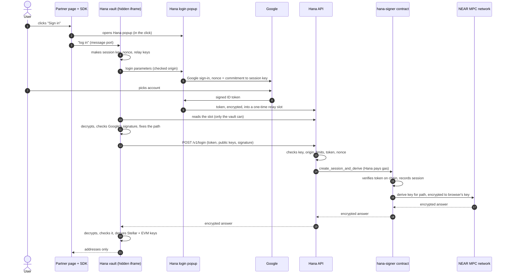
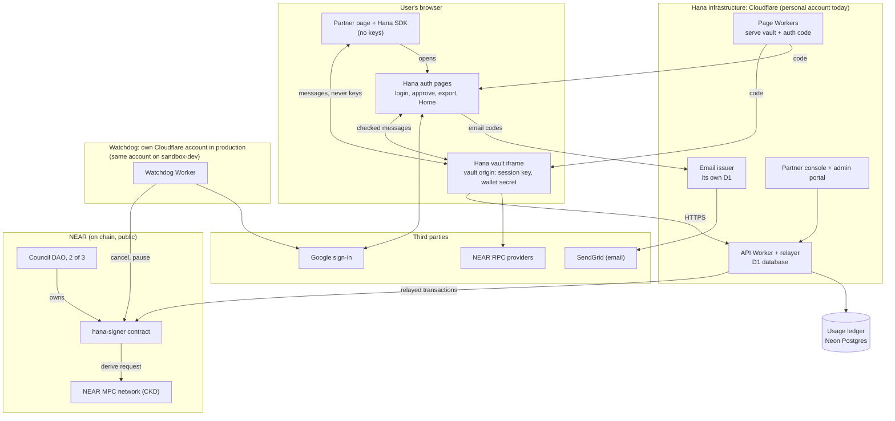

# Hana ID: a candid system briefing

A private briefing for the founder: how Hana ID works, what it protects, where it is weak, and how to answer hard
questions honestly. It states every gap plainly. Decide later what to share outside the company.

Last verified: 2026-11-10 against `origin/develop` @ 5bbd2a60 (branch `docs/system-overview`: new doc, written from the
reference docs and checked against the code where they were vague; no code changed). Where the docs lag the code or git,
this file says so. Sandbox-dev's live state is as `docs/operations.md` "What sandbox-dev runs" records it, corrected on
2026-11-10 by the person who ran that day's deploy and tests (Hana Home, the email co-signer, alerting, the Google
consent screen, partner onboarding, the demo site, priorities). Nothing else here was checked against the live system.

How to read it: section 1 is the one-page version. Sections 2 and 3 explain the moving parts. Section 4 is the security
case, including what Hana itself can do. Section 5 is the question bank. Section 6 is where things stand. Section 7 is
the glossary: every term in bold is there.

**The four facts to keep in mind throughout**

1. Everything runs on NEAR **testnet** only, in one environment (**sandbox-dev**), on the founder's personal
   Cloudflare, Neon and Google accounts, on free tiers.
2. **No external audit** has happened. Every security review so far is internal.
3. Mainnet readiness: **50 of 132** checklist rows are done (19) or built (31). 54 are not built, 23 need a decision.
4. Many protections are designed and built but proven only in tests, with stand-ins (a mock MPC, fake AWS KMS, a
   paging stand-in). Say "built and tested", not "proven in production".

---

## 1. Hana ID in one page

**What it is.** Hana ID is an embedded wallet service, like Privy or Web3Auth. A partner (a web app such as Sodax) adds
Hana's SDK to its site. The partner's users click "Sign in", pick a Google account (or type an email and a code), and
get a **Stellar** wallet and an **EVM** wallet (one address for Ethereum, Base and other EVM chains). There is no seed
phrase and no browser extension. Users never see NEAR: NEAR is Hana's machinery, not the user's chain.

**The one idea.** Keys are not stored anywhere. Each time a user logs in, the key is **derived on demand**:

1. A Hana smart contract on NEAR, `hana-signer`, checks the user's Google login token itself, on chain.
2. Only then does it ask NEAR's **MPC network** (a group of independent nodes that jointly hold a master secret) for
   the user's key, using a feature called **CKD** (confidential key derivation).
3. The MPC network's answer is encrypted so that only the user's browser can open it. Hana's servers pass it along but
   cannot read it.

The same Google account in the same partner app always gets the same addresses, on any device. A different partner app
gives different addresses, because each partner has its own **scope** (its own on-chain namespace).

**What it means for each party, in one sentence:**

- **User:** "I sign in with Google and get a wallet; every transaction asks me to approve it in a Hana window (unless I
  accepted an app's auto-approve rules), and I can export my private keys whenever I want."
- **Partner:** "I add an SDK and get standard wallet interfaces (EIP-1193 for EVM, a Stellar signer), without ever
  touching my users' keys or Google tokens."
- **Hana:** "We run the contract, the servers that relay logins, and the pages that hold keys in the browser; we never
  store a key, but users must trust the code we serve."

**Honest comparison.** Hana's specs summarise how other embedded-wallet providers describe their designs in their
public docs (read late October 2026, mostly about their native-app SDKs). As far as those public descriptions go:

| | Hana ID | Typical embedded wallets (Privy, Turnkey, Magic, Dynamic, Web3Auth) | Custodial wallet (exchange-style) |
|---|---|---|---|
| Where the key lives | Nowhere at rest. Derived by NEAR's MPC network per login, opened only in the user's browser | Varies: a key held in the provider's secure enclave (TEE), split shares with one held by the provider, or the full key handed to the app (Web3Auth) | The custodian holds it |
| What unlocks it | A Google token checked **on chain** by Hana's contract | The provider's own servers check the login | The custodian's account system |
| Who can sign | Only Hana's vault in the user's browser, after an Approve in Hana's own window (or an auto-approve rule the user accepted) | In several providers' native SDKs, the app holds a credential that can request signatures without a provider-drawn confirmation | The custodian |
| Per-app isolation | On chain: a partner's users' keys can't be derived in another partner's scope | Provider-specific | n/a |
| Export | Always on; partners can't turn it off | Privy lets partners disable it; Web3Auth gives the app the key | Usually withdrawal only |
| Still trusted | The code Hana serves to the browser, Google, NEAR's MPC network, Hana's council | The provider's servers or enclaves, the identity provider, the code served | The custodian |

What is genuinely different: no Hana server or enclave holds a user's key or a share of the MPC secret (Hana's server
does keep a per-login unlock key for reloads, useless without the user's device); the login check that releases a key
runs on chain where anyone can audit it; and partners never get a signing credential.

What is **not** different, and must never be implied otherwise:

- Like every web wallet, users trust the code that Hana's servers send to their browser. A malicious update to Hana's
  pages could steal the keys of everyone who loads them while it is live (section 4b).
- Users trust Google (or, for email users, Hana's email service) to sign in only the real person.
- Users trust NEAR's MPC network, a young system, much as other providers ask users to trust their enclaves.
- Hana's own pages and servers are needed to log in at all. There is no standalone recovery tool yet.

Sources: `docs/context.md`, `docs/architecture.md` "Components", `docs/security.md` "Trust roots in one paragraph",
`docs/native-apps-spec.md` "How other embedded-wallet providers do it", `docs/identity-token-spec.md` "What Privy
offers", D7, D10, D40, D41, D42.

---

## 2. A login, step by step

### 2.1 Google login (first time on this device)

In words:

1. The partner calls `hana.login()` when the user clicks. The SDK opens Hana's login popup on Hana's **auth origin**
   (Hana's page domain for login, approval and export) and tells the **vault**, a hidden iframe on Hana's **vault
   origin**, to start.
2. The vault makes a fresh **session key** in the browser. It is "non-extractable": the browser won't let any code read
   it out, even the vault's own. The vault also computes a **nonce** that commits to that session key.
3. The popup sends the user to Google with that nonce. Google's signed **ID token** therefore names this session key:
   a token stolen in transit opens nothing for anyone else.
4. Google returns the token to Hana's popup, which encrypts it and drops it into a one-time **relay slot** on Hana's
   API. Only the vault holds the key to read it, so the API stores ciphertext it can't open.
5. The vault reads the slot, checks Google's signature itself, and fixes the **path** (`scope#google#<Google user id>#0`).
   The path decides the address. The vault never takes a path from the server.
6. The vault sends `POST /v1/login`. The API checks the app's publishable key, the page's origin, rate limits, the
   token and the nonce, then **relays** one NEAR transaction from Hana's relayer account (Hana pays the gas).
7. On chain, `hana-signer` verifies the Google token against Google's public keys stored in the contract, recomputes
   the nonce, records the session, and asks the MPC network for the path's key, encrypted to a one-time key the vault
   made.
8. The answer comes back through the API. The vault decrypts it, checks it against the MPC network's public key that
   is pinned in Hana's build (so a lying server or RPC can't swap the key), and derives the Stellar and EVM keys.
9. The partner page receives the addresses. It never sees a key or a token.

| Party | Sees | Never sees |
|---|---|---|
| Partner page | Addresses; signatures it asked for; later an identity token | Keys, Google token, nonce, session key |
| Hana API | The Google token (openid-only claims) and public keys, in transit | The derived secret, the private key, the session private key |
| NEAR (public, forever) | The Google token in the transaction arguments, the scope, the session record | The key (the MPC answer is encrypted to the browser) |
| Google | That the user signed in to Hana's (or the partner's) Google client | Anything about the wallet |
| NEAR MPC network | A request for a path | The derived secret (it's encrypted to the browser's key) |

Timing (late-October testnet measurements from Malaysia, small samples): the on-chain part's median was about 7.4 s; a
whole login about 9–12 s plus the user's time at Google. A reload unlock was about 0.9 s warm, about 2 s cold.

### 2.2 Email login

Only for apps where email login is turned on. The popup shows "Continue with email". The user types an address; Hana's
**email issuer** (a separate Hana service) emails a 6-digit code; the user types it; the issuer signs an **email token**
naming a pseudonymous email user id (an HMAC of the address under a secret key, never the address itself). From then on
the login is the Google flow above, with the email token in place of Google's. The contract checks the email token
against the issuer's public keys and signing policy stored on chain.

**Account linking**: when a Google user and an email user are the same person, the system can join them so both
methods open one wallet. Linking never moves an address: the newer method opens the existing wallet.

### 2.3 Returning user (reload or new tab)

In the default **persistence** mode, after login the vault stores the wallet's root secret on the device, encrypted
under a key (**K_s**, the **share**) that only Hana's API holds (itself wrapped by a server secret, `VAULT_KEK`). On
reload, the vault proves possession of the session key and the API hands back K_s for that one share. No NEAR
transaction, no MPC call. Neither half alone opens the wallet. Shares end at the session's limits (default 12 h
absolute, 2 h idle; partners can set up to 23 h 50 min), at logout, or when revoked.

### 2.4 Signing with the approval popup

A signing call made in a click opens Hana's **approval popup** on the auth origin. The popup decodes the transaction
bytes itself and shows what is being signed. The Approve button is guarded: it arms only 1 s after the window shows and
after a real mouse, touch or keyboard gesture, so a page can't trick a click onto it. The vault re-checks that what was
approved is exactly what was queued, then signs locally. `personal_sign` and Stellar messages always need the popup.
Raw signing (signing a bare hash) is off by default, always needs the popup with a red warning, and is refused for test
apps.

### 2.5 Auto-approve

A partner can set an **auto-approve policy**: rules such as "this contract, this function, at most this value per day".
A new or changed policy takes effect only after a delay, and each user must accept that exact policy once in a Hana
consent screen. After that, matching requests are signed without a popup, within the daily limits. The consent is
recorded on Hana's server, so the user can stop it from another device; an open tab stops auto-signing within about
10 s. Auto-approve fails closed: if Hana can't record or confirm the consent, the request goes to the popup.

### 2.6 Key export

From the vault's "Export" button, a separate top-level Hana window opens. It runs **its own fresh login** (Google with
a forced re-sign-in, or an email code), derives the key itself (it never reuses the vault's), and checks the address
matches. After the user types `EXPORT`, it shows the private key behind Show key / Copy key, both guarded like Approve.
The key hides after 60 s and is erased 5 minutes after it was derived. Exports are limited to 3 per hour per user per
app, and each one is recorded for Hana staff (`key_exported`). Partners can't switch export off.

### 2.7 Hana Home's exit route

**Hana Home** is a Hana page (`/home` on the auth origin) where a user signs in and sees every partner app whose wallet
Hana can open for them, with addresses, and can "Move this wallet to another wallet app" (export). It exists so that a
partner shutting down, or turning off Hana's shared login, never strands users.

The guarantee rests on the **exit client**: a Hana-held Google client that the contract (version 4, live on
sandbox-dev) accepts for **every** scope, whatever the partner does. Exit sessions are capped on chain at 30 minutes and
3 uses, and can't link accounts. The watchdog alarms on bursts of exit sessions.

Honest state: Home batches H1–H8 and H11 (the server side, the exit client, the Home page, export from Home and Home
billing) are live on sandbox-dev, deployed on 10 November from `develop` at 5bbd2a60, every Worker on that commit. That
day the founder signed in to Home with Google, saw the same wallet addresses as in the partner app, and did one real
key export from Home on testnet; the exported key matched the one the app's own export gives, and an export reached
from a link was refused as designed. That is one account, through Google and Hana's shared login only: an email user's
Home sign-in and the exit route have not been tried live. H9 (devices and stopping auto-approve, device sessions and
email sharing from Home) and H10 (email users in Home, and Home through the exit client) are built and independently
security-reviewed with fixes in; they are being merged, not yet deployed. Until H10 ships, Home export doesn't cover
apps reachable only through the exit client or by email. H12 (linking Home from the consent and approval screens, and
real testnet runs of the remaining cases) is not started. Until then nothing links to Home: it is reachable only by
typing its address.

Sources: `docs/architecture.md` "Flows", "Key persistence across reloads", "Signing", "Key export", "Hana Home identity";
`docs/context.md` timings; `docs/hana-home-spec.md`; `docs/hana-home-build-plan.md`; D36, D41, D43, D59, D99, D111, D430,
D468, D486.

---

## 3. Component by component

Trust boundaries in one line each: the **browser** holds keys briefly; **Hana's infrastructure** holds no user key
but serves the code that does; the **chain** decides who gets a key; **third parties** (Google, the MPC network,
SendGrid, RPC providers) are trusted for specific things listed below.

### The `hana-signer` contract (on NEAR)

- **Does:** checks login tokens (Google's RS256 signatures, the email issuer's signatures), keeps the registry of
  scopes and their Google clients, records sessions, and asks the MPC network for keys.
- **Why:** so the decision "this person may have this key" is made by public, auditable code, not by Hana's servers.
- **Holds:** Google's and the email issuer's public keys, the scope registry, sessions, governance state. No secret.
- **Trusts:** the public keys it holds, the MPC network, its owner (the council DAO).
- **If down:** it is down only if NEAR is; then no new logins (reloads still work: they don't touch the chain).
- **If compromised:** whoever controls its code controls everything. On mainnet, code changes only by a council upgrade
  with a public 72-hour delay. On sandbox-dev today the signer account still has a full-access key (kept for speed),
  so whoever holds it can redeploy at once.

### NEAR's MPC network and confidential key derivation (CKD)

- **Does:** holds a master secret split across nodes; for a request from `hana-signer` it computes a per-path secret and
  encrypts it to a one-time key the browser made.
- **Why:** so no single party, Hana included, ever holds users' keys.
- **Holds:** shares of the CKD master secret. The docs describe the network as 17 nodes, threshold 11, running in
  trusted hardware (TEEs). Hana hasn't independently checked those figures; they come from NEAR's design.
- **Trusts:** `hana-signer`'s request (only `hana-signer` can ask for `hana-signer`'s paths).
- **If down:** no new logins or exports anywhere. Users with a live session keep signing.
- **If compromised:** 11 or more colluding nodes could compute any user's key. A new MPC master key would change
  every address. Testnet's MPC has weaker operator standards than mainnet's, which is why test apps can't sign for
  mainnet chains (except the demo, section 4g).
- **Not Hana's.** Hana can't restart, fix or speed it up.

### The relayer and its pools

- **Does:** Hana's NEAR account pays for login transactions, so users need no NEAR.
- **Holds:** "function-call keys" that can only call listed contract methods, each with a spending allowance: a session
  pool (default 3 keys × 2 NEAR), an owner pool (1 × 0.5 NEAR), a Home pool (1 key, 5 NEAR on sandbox-dev). A separate
  updater key on the contract account (1 NEAR) posts Google's new public keys.
- **If down or empty:** logins stop. Topping up is manual today; the watchdog alerts on low funds.
- **If a key is stolen:** the thief can burn that key's allowance (denial of service). It can't take a user's key:
  every method still needs a valid token or a session signature.

### The API Worker

- **Does:** the gate (publishable key, origin, rate limits), checks every request before relaying it, runs the relayer,
  holds vault shares, runs the login relay, renders the vault page, syncs Google's keys to the contract (delayed),
  mints identity tokens, keeps the wallet directory.
- **Holds:** server secrets (`VAULT_KEK`, relayer keys, the updater key, the identity signing key, pseudonym keys) and a
  D1 database (section 4f). No user key.
- **Trusts:** Cloudflare, NEAR RPC providers.
- **If down:** no logins, reloads, exports or identity tokens. An already-unlocked tab can still sign through the popup
  while the pages load.
- **If compromised:** treated as the single trust root (below): it renders the vault page, so a compromised API can
  serve a vault that steals the keys of every user who loads it.

### The vault (iframe) and the SDK

- **Vault does:** makes the session key, computes nonces and paths, decrypts the MPC answer, holds the wallet's root
  secret (**PRK**) in memory, signs. **SDK does:** mounts the vault, opens popups, exposes standard wallet interfaces.
- **Holds:** the vault holds keys (in memory; on disk only encrypted under the server share). The SDK holds nothing
  secret.
- **Trusts:** the code Hana serves; the browser.
- **If compromised:** a modified vault reads every key it handles. The SDK on a partner's page is untrusted by design.

### Hana's login, approval and export pages (the auth origin)

- **Does:** Google and email sign-in, the approval popup, consent screens, key export, email sharing, Hana Home.
- **Holds:** transient tokens during a login; an exported key on screen for at most 5 minutes.
- **If compromised:** it can capture the tokens of logins it handles, approve anything it shows, and export keys. In
  production the vault and auth pages must sit on two different registrable domains, so browsers isolate them in
  separate processes. Sandbox-dev's two origins share one domain (accepted for testnet).

### The email issuer

- **Does:** sends login codes through SendGrid, checks them, and signs email tokens. Also answers "does this email
  already have a wallet?" for account linking, and keeps a directory of verified email addresses for Hana staff.
- **Holds:** the email signing key (an RSA key held as a Cloudflare Worker secret on testnet), the secret that fixes
  every email user's id (never rotated: losing it locks out every email user), and its own D1 with verified addresses
  in clear.
- **Trusts:** SendGrid and the user's mailbox (whoever reads the code can log in).
- **If down:** email logins stop; Google logins of apps with email may fail where they need its linking answer.
- **If compromised:** **one signer today.** Whoever can read the issuer's secrets can mint a token for any email user
  and open their wallet, without the user. Before mainnet: the key moves to AWS KMS (code built, not wired), and a second,
  independent co-signer is designed with its decisions confirmed. Its first two batches (the contract's governed policy
  change and the co-signer's core) are built on branches and parked, by the founder's choice on 10 November, to put
  partner testing on testnet first; they are not merged and not security-reviewed. Email login still has one signer.

### The identity token (for partners' backends)

- **Does:** a short-lived (≤ 1 hour) signed token telling a partner's server who the user is in that app (a
  pseudonymous `u1_…` id per scope), which wallet addresses they proved, and the session. Email only if the user chose
  to share it.
- **Holds:** nothing stored by Hana per token. Signed with a P-256 key that is a Worker secret on testnet.
- **If the signing key leaks:** anyone can forge any user's identity at every partner that trusts the token, until the
  key is removed. Hana's own docs say partners **must not use identity tokens for anything of value** until the AWS
  KMS signer runs in production. The watchdog checks Hana's published keys against pins, which detects (not prevents)
  a swapped key.

### The watchdog

- **Does:** every 5 minutes, fetches Google's public keys itself and compares them with what's on chain; cancels a
  pending key Google doesn't publish, deletes the updater key that proposed it, and pauses the contract if a forged key
  is ever active. Also pins the email issuer's keys, the identity token keys and the exit clients; watches link volume,
  exit volume, governance changes and relayer funds. Sends alerts (pager, Slack, email) and a heartbeat.
- **Why:** the updater key lives in the API's secrets; the watchdog bounds what a thief can do with it.
- **Holds:** its own NEAR key that can only cancel, confirm, pause and delete updater keys (denial of service at worst).
- **Honest state:** on sandbox-dev it runs on the **same** Cloudflare account as the API (so a compromise of that
  account could silence it). In the 10 November test of the alert path, the email alert arrived within
  seconds; the phone pager, a free stand-in (ntfy.sh), failed from the Worker; Slack isn't set up. **Paging is not
  proven.**

### The council DAO and governance delays

- **Does:** owns the contract. A Sputnik DAO with three members; any action needs 2 of 3.
- **Plan for mainnet:** the two founders on Ledger hardware wallets plus an offline backup key neither founder can
  reach alone (where it is held is still undecided). Upgrades and owner changes wait 72 hours in public.
- **Sandbox-dev today:** three throwaway testnet accounts whose keys sit in one operator machine's `.secrets/`
  folder; delays of 60 s (governance) and 2 minutes (new issuer keys).
- Details in section 4d.

### The partner console and the admin portal

- **Partner console:** partners sign in with Google (invite only; Owner or Viewer). Security changes (origins, signing
  settings, members) need a fresh "Confirm with Google", are announced by email to the partner's security contacts, and
  take effect after a delay (24 hours on a production network, 60 s on sandbox-dev); anyone notified can cancel. Holds
  members' Google ids and emails and a 5-year audit log. No passkeys yet (required before a second partner joins).
- **Onboarding a partner:** a partner's scope is registered on chain by a council action that staff prepare in the
  admin portal and run from the command line. Partners can't self-onboard yet; fixes were built on 10 November and are
  being merged.
- **Admin portal:** Hana staff, behind Cloudflare Access with an exact staff email list. Shows users (including email
  addresses, with an audit row per read and per-staff reading limits), security monitoring, playbooks and system
  status.

### The usage ledger and billing

- **Does:** records one usage event per API request (Neon Postgres, AWS Sydney), settles each relayed transaction's
  real gas from the chain, and produces monthly statements (CSV, PDF).
- **Holds:** pseudonymous user ids (an HMAC per scope), never a Google id, email, IP or path.
- **Honest state:** usage capture is on on sandbox-dev. Stripe and self-serve billing are on hold; Sodax is billed by
  service contract. On the free tier,
  settlement can keep up with only about 3,600 relayed transactions a day.

### Hana Home

Described in 2.7. Holds nothing durable: the Home sign-in lives in page memory for 15 minutes. Its derives come from
its own relayer pool, with limits per user (10 an hour, 20 a day), per wallet (3 an hour) and per environment (500 a
day by default). An app's org pays for Home logins in its scope while the app is active; Hana pays after.

### The databases

| Store | Personal data it holds |
|---|---|
| API D1 (`DB`) | The **wallet directory**: users' Google and email ids joined to their wallet addresses, per scope. Vault shares (encrypted). Auto-approve consents. Email addresses users chose to share with an app (only while shared). Key-export and mainnet-demo events (24 months) |
| Email issuer D1 | The **user directory**: each email user's verified address in clear, and the Google email address of Google users in an environment with an email issuer (sandbox-dev has one), with the apps they used. Staff-only |
| Console D1 | Partner team members' Google ids and emails; invites; the audit log |
| Usage ledger (Neon) | Pseudonymous ids, request metadata, gas, statements. No email, Google id or IP |
| Watchdog D1 | Key ids, alerts, run logs. No personal data |
| NEAR (public) | Every login's Google token (openid-only: the Google user id, the client, times, nonce), scope and session |

Sources: `docs/architecture.md` "Components", "Data stores", "Relayer design"; `docs/security.md` "Parties", "Key and
secret inventory", "Known open issues" (e), (j), (l); `docs/governance-spec.md`; `docs/operations.md` "What sandbox-dev
runs"; `docs/mainnet-readiness.md` rows 5.4, 7.8, 7.15, 9.7; `envs/sandbox-dev.json`; D38, D81, D86, D121, D125, D269.

---

## 4. The security design

### 4a. Where keys live, and where they never live

| Secret | Where it lives | For how long | Never |
|---|---|---|---|
| MPC master secret | Split across NEAR's MPC nodes | Permanent (it defines every address) | With Hana |
| The CKD answer (48 bytes) | Browser memory | Zeroed as soon as the root secret is derived | On a server, on disk |
| Root secret (PRK) | Vault memory; on disk only encrypted under the server share | Until idle limit (default 2 h), session end (default 12 h), logout or a newer login | In plaintext on disk; at Hana |
| Stellar / EVM private keys | Derived per signature inside the vault, zeroed after | Milliseconds | Anywhere but the vault and the export window |
| Exported key | The export window's screen; the clipboard if the user copies it | Erased 5 min after derivation; hidden 60 s after Show | Sent to any server |
| Session key | Browser, non-extractable | ≤ the session (≤ 24 h on chain) | Readable by any script |
| Server share K_s | Hana's D1, encrypted under `VAULT_KEK` | Ends with the share | Useful without the device's record |

Hana's API never receives the derived secret, a private key or the session private key in any designed flow.

### 4b. What Hana can and cannot do

This is the section to know cold.

**For Google users, under the mainnet design:**

- Hana **cannot** open a user's wallet without that user signing in. To derive a key, the contract needs a Google token
  for that user with a nonce Hana chose. Hana can't forge Google tokens. To get around that it would have to post a
  fake Google key (delayed 2 hours in public; the watchdog cancels it and pages both founders) or upgrade the contract
  (delayed 72 hours in public, alerted). Both are visible and give users time to export.
- Hana **can**, through the pages it serves, steal the key of a user who loads a malicious version of the vault or
  login page. This is the real risk for any embedded web wallet and it is not bounded today. What limits it: a small
  vault bundle, a strict content security policy, no third-party scripts, the build id on every deploy, and Cloudflare's
  deployment history. None of these *prevents* a malicious deploy by someone with deploy rights; they make it harder or
  detectable afterwards. Bounding the page-serving trust root is listed as an open issue; no readiness row tracks it.
- Hana **can** deny service: suspend an app, stop relaying, and (through the council) pause the contract.
- Hana **cannot** block derivation for a partner scope that has its own Google client: suspension is API-side only,
  and anyone can call the contract directly with a valid token.

**For email users, today:**

- Hana's email issuer has **one signer**. Whoever can read the issuer Worker's secrets (on testnet), or misuse its AWS
  credential (the mainnet plan), or change what the issuer runs, can mint a token for **any** email user and open their
  wallet **without the user signing in**. The chain can't stop the use of the real key; the link-volume and exit-volume
  alarms only detect bursts, and testnet has no signing log. The plan is AWS KMS plus a second, independent co-signer
  (2 of 2). Neither is live.
- So for email users, "Hana can't take your funds" is **not** true today, even in principle. Say "email login trusts
  Hana's email service; we are adding hardware key custody and an independent co-signer before mainnet".

**A rogue Hana employee** has the powers of whatever they hold: Cloudflare deploy rights (the page risk above and
every server secret), the email issuer's secrets (every email wallet), a council key (nothing alone; two are needed).

**Someone who compromises Hana's servers** (the Cloudflare account): every key of every user who loads the vault while
it is compromised; the email issuer's key (every email wallet); the identity token key (forge identities at partners);
the updater key (bounded by delay and the watchdog). Pausing the contract stops new logins but not a malicious vault
reading a share already on a device.

**On sandbox-dev today, with real funds only in the demo:** the contract account's full-access key, all three council
keys, the email issuer key and the Cloudflare account are effectively in one person's hands, with 60-second delays. That
is fine for testnet, but it means no claim about bounded Hana power applies to sandbox-dev.

### 4c. What if X is compromised or fails

| X | Impact | What limits it | How it's detected | Unfinished |
|---|---|---|---|---|
| User's Google account | Attacker opens every Hana wallet of that user and exports keys; via Hana Home, every app's wallet, one quick re-sign-in each | Google's own security; export limit 3/hour per wallet per app | Hana records each export for staff; the docs describe no notice to the user | Key rotation for a leaked user key is not built |
| User's device (malware, extension) | Everything the user can do, including reading an exported key; a disk copy plus a live share opens the wallet | Session idle and absolute limits; logout; keys zeroed in memory | Not by Hana | No web wallet can prevent this |
| Partner's website (XSS, bad dependency) | Start a visible login, read addresses, queue requests, get signatures that fit an accepted auto-approve policy | Every other signature needs Approve in Hana's window; policy limits; raw signing off by default | Partner's own monitoring | — |
| Partner's portal account | Change origins, auto-approve policy, raw signing, keys, members, suspend | Security changes need a fresh Google confirmation, are emailed to security contacts and delayed 24 h (production); users must accept any new policy; can't touch other orgs | Notices and the audit log | Passkeys for members not built |
| Partner's own Google client (if it has one) | Whoever controls it can get its users' keys when they sign in through a page it controls | Only that scope; Hana's default (shared client) avoids it | Not detectable by Hana | Written warning to such partners |
| Hana's API or Cloudflare account | Keys of every user who loads the vault meanwhile; every server secret; D1 tampering | Governance bounds the updater key; the watchdog (own account in production); CSP | Deploy history; watchdog alerts; drift detection on D1 | Page trust root unbounded; watchdog on the same account on sandbox-dev |
| Vault or auth pages (domain, DNS) | Same as above for users who load them | Two registrable domains in production (process isolation) | Unexpected content or certificates | Production domains not chosen |
| Email issuer key | Every email user's wallet, and accounts linked to an email identity; through the exit client, also scopes that dropped email | Installing a new key is governed and pinned by the watchdog; use of the real key is not bounded at 1 of 1 | Link and exit volume alarms (bursts only) | AWS KMS and the second signer |
| Relayer keys | Burn their allowance; logins stop | Methods and allowances fixed on chain | Watchdog funds alerts; daily nonce check (needs usage capture, which is on on sandbox-dev) | Mainnet relayer and funding |
| Updater key | Propose a fake Google key | Public delay (2 h planned; 2 min on sandbox-dev); the watchdog cancels and deletes the key; pauses if one goes active | Critical alert | Mainnet delay length to decide from measured Google rotations |
| One council member | Propose and vote once; nothing executes | 2 of 3 needed; member replacement command | Watchdog governance alerts | Ledgers, mainnet DAO, backup key location |
| The whole council (2 of 3) | After 72 h: any upgrade (so anything), owner transfer; at once: pause, unpause, remove keys and watchdogs | Delays are public and alerted to both founders; users can export meanwhile; no independent guardian can cancel | Watchdog critical alerts | Public notice to partners on an upgrade not built |
| NEAR RPC provider | Fail or delay logins; refuse a login with a wrong view | Can't forge the user's own key (pinned MPC key check); linked-account paths checked on two providers | Failover logs; watchdog `rpc_failing` | Keyed, independent providers |
| NEAR itself (halt) | No new logins or exports; reloads still work | Users' Stellar and EVM wallets are unaffected on their own chains | Obvious | The docs don't analyse a NEAR consensus attack |
| NEAR MPC network | Down: no new logins. 11+ colluding nodes: any user's key | Threshold; trusted hardware (per NEAR) | Login failures (`ckd_failed`) | Mainnet MPC key not yet pinned |
| Cloudflare (outage) | Hana's pages, API and email issuer stop: no logins, reloads, approvals; auto-approve also stops (it re-checks with the API every 10 s) | Exported keys and users' chains are unaffected | Obvious | No second hosting provider |
| Google (outage, rotation, compromise) | Outage: no Google logins (email still works). A forged Google: any Google user's key. A rotation mishandled: logins with the new key fail until it's active | Delayed, watchdog-checked key sync; watchdog confirms Google's real keys early | Watchdog compares Google's keys from its own fetch | Mainnet delay length; Google brand verification |

### 4d. Governance: who can change what

| Change | Who | Mainnet plan | Sandbox-dev today | Who can stop it |
|---|---|---|---|---|
| Contract upgrade | Council (2 of 3) proposes; anyone executes once due | 72 h, public, critical alert | 60 s; also the full-access key, at once | Only the council (no guardian at launch) |
| Owner transfer | Council | 72 h | 60 s | Council |
| New Google key | API's updater key or council | 2 h (provisional) | 2 min | Watchdog cancels forged keys; council cancels |
| New email issuer key | Council only | 72 h, never confirmed early | 60 s | Watchdog cancels unpinned keys |
| Pause | Council or watchdog | Immediate | Immediate | Council unpauses, immediately |
| Add an exit client / remove one | Council | Add: 72 h. Remove: immediate, permanent | Add: 60 s | — |
| A scope's Google clients and owners | Scope owners (the partner) | After the scope's change delay | 60 s | Scope owners cancel |
| Origins, auto-approve policy, raw signing | Partner owner, with fresh Google confirmation | 24 h after the email notice | 60 s | Owners, security contacts (email link) |
| Shared Google clients | Council | Removal immediate; addition after the change delay | 60 s | Council |

Pause stops every login, derive and token path; it never stops governance, cancels or session revokes. It can't move
anything. After a forged key, the runbook retires older sessions before unpausing.

### 4e. Recovery and exit

- **Key export** is always available and partners can't remove it. It is the user's exit to any Stellar or EVM wallet.
- **Hana Home** lets users reach every app's wallet from one Hana page, even after a partner shuts down or switches off
  Hana's shared login, through the exit client. It runs on sandbox-dev, but nothing links to it yet, so users can't
  find it, and the exit route hasn't been tried live (section 2.7).
- **If a partner shuts down:** its users' wallets still exist on their chains. Through Home and the exit client, Hana
  can still open them. A suspended or deleted app doesn't stop Home: Home works by scope. Exception: until Home's export
  covers the exit and email routes (H10: built and reviewed, being merged, not deployed), some users of a partner that
  removed every route could see their wallet but not move it from Home.
- **If Hana shuts down:** funds stay on Stellar and EVM chains, untouched. But logging in needs Hana's pages (Google
  only returns tokens to Hana's registered page), Hana's relayer (or someone paying NEAR gas directly), the contract
  (whose Google keys are kept current by Hana's cron or the council), and NEAR's MPC network. A standalone, open-source
  recovery tool that works without Hana's servers is deferred, not built. So today the honest answer is: "export your
  keys while we run; we are designing a way to recover without us".
- **If the MPC network fails permanently:** no one can derive keys again; only exported keys remain. A new MPC master
  key would change every address.
- **Leaked user key:** moving a user to a new key index (rotation) is planned before mainnet, not built.

### 4f. Privacy

- **What Hana knows:** for each user, their Google id or email id per scope, joined to their wallet addresses (the
  wallet directory, staff and partner views); their verified email address (the email issuer's directory, staff only,
  each read audited), including Google users' email in an environment with an email issuer; when they log in (usage
  ledger, pseudonymous); key exports. Login popups in such environments ask Google for the `email` scope, though only
  an openid-only token goes on chain.
- **What partners see:** their users' pseudonymous User ID (`u1_…`, different per partner), Support ID, wallet
  addresses, first and last seen, which login methods are connected; an email address only if the user chose to share
  it with that app.
- **What is public on chain, forever:** every login's Google ID token in the transaction arguments. Hana's API refuses
  tokens carrying anything beyond openid claims, so no email, name or picture goes on chain. But the token does carry
  the user's **Google user id** (`sub`), the client and timestamps. Google's id is the same across every Hana scope, so
  anyone reading the chain can see that one Google account logged in to several Hana apps, and when. Email users appear
  under a pseudonymous id. Home derives are public too: "a partner can't tell who left through Home" is not a property
  of the system.
- **Retention:** raw usage 24 months, statements 7 years, audit 5 years, key-export events 24 months; the company's
  accountant must confirm them. An erasure tool deletes a user across the ledger and directories; it can't touch the
  chain.
- **Legal characterisation:** the docs reference Australian obligations (Privacy Act APP 11, ATO record keeping). Who
  is controller or processor between Hana and partners is for counsel.

### 4g. Known limits and accepted risks

- **Page-serving trust root:** a malicious Hana page update can steal keys of users who load it. Open, unbounded.
- **Email login is 1-of-1:** the email service alone can open any email wallet. KMS and a co-signer before mainnet; the
  co-signer's first batches are parked while partner testing comes first.
- **The mainnet demo:** one Hana test app may sign real transactions on Base and Stellar's public network, up to $9.99
  each, fee included, using **keys derived on testnet**. The cap limits what a page can take per request, not what the
  testnet MPC's operators (or anyone who compromises it) can take: everything at the address. There is no balance
  cap, only a warning above $10. It is dev-only and doesn't exist in production. It runs on a public but unlisted demo
  site of the Sodax sample on testnet, with a permanent warning, so anyone who has the address can reach it. The price
  table has an expiry and must be reviewed before each demo. Sandbox-dev wallets are discarded at the address freeze.
- **Auto-approve residuals:** a contract function the rules can't see into (for example a `withdraw(to, …)` under a
  permissive address rule) can still pass; only partner-listed contracts are ever auto-approved, and the consent screen
  warns.
- **Messages, typed data and raw signatures aren't tied to one network** in the approval check (accepted; the popup
  says so).
- **Process isolation:** on Chrome for Android and on Safari/iOS the vault may share a process with the partner page;
  short unlock windows and zeroing are the mitigation.
- **Google can break the popup:** if Google enforced a stricter window policy (COOP) on its sign-in pages, popup logins
  would fail; a canary checks before each release.
- **Identity tokens:** testnet key is a Worker secret; partners must not rely on them for value yet.
- **Home billing:** strangers can run up a partner's Home line (about $10 a day at the default ceiling); left uncapped
  for now, to settle before mainnet.
- **CI is off:** checks run locally (`pnpm verify`) before merges; nothing enforces them.

Sources: `docs/security.md` "Trust roots", "What a compromise gives", "The exit client", "Hana Home's derive", "Hana
Home's billing", "Known open issues" (c), (e), (j), (k), (l), (o)–(r); `docs/governance-spec.md` "Pause", "What each
party can do"; `docs/email-login-spec.md` "Trust statement"; `docs/playbooks.md` `api-or-cloudflare-compromised`,
`mpc-ckd-outage`; `packages/web/src/auth/google.ts`; `apps/api/src/claims.ts`; D12, D33, D40, D41, D80–D86, D121, D269,
D270, D428, D485, D605.

---

## 5. Hard questions, honest answers

Each answer: what to say aloud, the detail behind it, and where it matters, what not to claim.

### Security and custody

**1. Is this non-custodial?**
*Say:* "Hana never stores or holds a user's key. A key is derived only when the user signs in, by a public contract
and NEAR's MPC network, and it is opened only in the user's browser. Whether that is 'non-custodial' in law is for our
counsel."
*Detail:* Who can cause a key to be derived: anyone holding a valid Google token for the user with a nonce they chose
(Google, the user, or a partner that runs its own Google client and gets the user to sign in), or a valid email token
(the email service), or whoever controls the contract's code (the council, after 72 h). Hana's pages also handle keys in
the browser.
*Don't claim:* "Hana can never access keys" (its pages can) or a legal conclusion. Legal advice is a readiness item, not
done.

**2. Can Hana steal funds?**
*Say:* "Not silently through the contract: that needs a public 72-hour upgrade or a fake Google key the watchdog cancels.
The real risk, as for every web wallet, is the code we serve to the browser; and today, email login trusts our email
service fully."
*Detail:* Section 4b. A malicious page affects users who load it while live. Email: one signer, a Worker secret on testnet.
*Don't claim:* "impossible", or that sandbox-dev has these bounds (it doesn't).

**3. Could a rogue employee take funds?**
*Say:* "One council key can't do anything alone. But someone with deploy rights to our Cloudflare account could ship a
malicious page, and someone with the email issuer's secrets could open email wallets. Production moves those powers to
company accounts, hardware keys and, for email, a second signer."
*Detail:* Today one person's accounts hold everything on testnet. Separation of duties is a mainnet item.

**4. What stops a malicious frontend update?**
*Say:* "Honestly, prevention is limited, as for every embedded wallet: a strict content security policy, no third-party
scripts, a small reviewed vault, and every deploy stamped with its commit so we can check it. Detection is after the
fact. Bounding this further is an open item."
*Don't claim:* subresource integrity, reproducible page builds, or independent monitoring of the pages: none exists.

**5. What if Hana's servers are hacked?**
*Say:* "The attacker could steal keys of users who load our pages during the breach, and email wallets. They can't
quietly change who the contract gives keys to: that's delayed in public and watched by an independent watchdog."
*Detail:* Playbook: take the account back, pause, redeploy, rotate every secret, tell partners; affected users must move
funds.

**6. Why trust a contract that checks Google's signatures? What if Google rotates or is compromised?**
*Say:* "Google signs the token; the contract checks it with Google's public keys. New Google keys reach the contract
only after a public delay, and an independent watchdog checks each against Google's own published list, cancelling
fakes. If Google itself were compromised, any Google-login wallet anywhere would be at risk; that's the trust you place
in Google sign-in."
*Detail:* The mainnet delay (2 h) is provisional, pending measured Google rotations. Too short risks a forgery when the
watchdog is down; too long risks logins failing with a new Google key. Google's servers serve different key sets for a
day or two during a rotation; the sync waits 24 h before removing a key.

**7. Who can open email users' wallets?**
*Say:* "Today, the email service's signing key. We're moving it to AWS KMS and adding an independent co-signer, so one
compromise isn't enough."
*Detail:* Also the user's mailbox (whoever reads the code), SendGrid in transit, and a Workspace admin for their domain.
The co-signer is designed; its first two build batches are parked on branches, unmerged and unreviewed, while partner
testing on testnet comes first.
*Don't claim:* that a co-signer protects email users today.

**8. Can a partner rug its users?**
*Say:* "On Hana's default shared Google client, no: a partner can't derive its users' keys, and every signature goes
through Hana's window. Partners on their own Google client could get keys of users who sign in through their pages,
which is why we discourage it. A partner can't remove export or Hana Home."
*Detail:* A compromised partner page can still get signatures inside an accepted auto-approve policy.

**9. What if a user's Google account is hacked?**
*Say:* "The attacker can do what the user can, including export. Google's account security is the user's first line;
exports are rate-limited and recorded."
*Don't claim:* user alerts on login or export (not described in the docs).

**10. Has it been audited?**
*Say:* "Not yet. An external audit is a hard gate: no live keys are issued before it. We've done internal security
reviews of each batch."
*Don't claim:* "audited", "security reviewed by third parties". No auditor is named.

**11. Who holds the admin keys?**
*Say:* "On mainnet, a 2-of-3 council: the two founders on Ledger hardware wallets and an offline backup. On testnet, test
keys on our operator machine."
*Detail:* Where the backup key is held is undecided. The mainnet DAO doesn't exist yet. On sandbox-dev the contract
account also keeps a full-access key.

**12. What if a user's key leaks?**
*Say:* "They move funds to a new wallet, as with any wallet. Built-in rotation to a fresh key is planned before mainnet."

### Decentralisation and dependencies

**13. What's your single point of failure?**
*Say:* "Two: the code we serve to the browser, which must be honest, and our hosting, which must be up for logins.
NEAR's MPC network is a third dependency we don't run."
*Detail:* The docs call the API Worker and Cloudflare account the single trust root.

**14. What if NEAR or the MPC network halts or is attacked?**
*Say:* "A halt stops new logins; users with a live session keep signing, and their funds are untouched on Stellar and
EVM. A large collusion in the MPC network (11 of 17 nodes, per NEAR's design) could compute keys; that's the same
class of trust as other providers' enclaves."
*Don't claim:* we've analysed NEAR consensus attacks (the docs don't).

**15. Is the MPC network really decentralised?**
*Say:* "It's NEAR's network, run by independent node operators in trusted hardware. We pin its public key in our code
and check every answer against it."
*Don't claim:* operator names or independence we haven't verified. Testnet's network has weaker standards.

**16. What happens to users if Hana goes bankrupt?**
*Say:* "Their funds stay on their chains. Today they need our service to log in, so the safe path is to export keys
while we run. A recovery tool that works without us is planned."
*Detail:* Section 4e. Google returns tokens only to Hana's registered pages; Google's keys on chain need updating.
*Don't claim:* users can recover without Hana today.

**17. What happens if a partner shuts down?**
*Say:* "Hana Home lets users reach their wallet from Hana's own page and move it, whatever the partner does."
*Detail:* Home runs on sandbox-dev (testnet). One account has tried it live, through Google and the shared login,
including one real key export. Nothing links to it until H12, so users reach it only by typing its address. Email
users' Home sign-in and the exit route are built (H10, being merged) but not deployed or tried live.
*Don't claim:* it's live for users, or that it has been proven for email users or through the exit client.

**18. Why NEAR, when users never touch NEAR?**
*Say:* "NEAR's MPC network offers confidential key derivation, and a NEAR contract can check the login itself. Users only
see Stellar and EVM."

**19. What if Cloudflare goes down?**
*Say:* "Logins, reloads and approvals stop until it's back; funds are unaffected, and exported keys work anywhere."

**20. Can Google cut you off?**
*Say:* "Our Google login needs a verified consent screen; that verification is a mainnet item. A change in Google's
sign-in window policy could break the popup; we test for it before every release."
*Detail:* Today the consent screen for Hana's shared Google login is in Testing mode (External), with a lifetime cap of
100 accounts: only listed test accounts can sign in with Google. That limits partner testing until it is published,
which is planned with the move to company accounts. Email login is unaffected.

### Business and regulation-adjacent

**21. What data do you hold under privacy law?**
*Say:* "Pseudonymous ids and wallet addresses per app, verified email addresses for support, usage for billing. No
names or photos. We keep retention limits and an erasure process; counsel and our accountant confirm the details."
*Detail:* Section 4f. The email directory includes Google users' emails where an email service runs.

**22. Do partners see users' emails?**
*Say:* "Only if the user chooses to share it with that app, on a screen naming the app and the address, and they can
stop sharing."

**23. What is public on chain?**
*Say:* "Each login's Google token, minus any personal claims: no email or name, but Google's user id is visible, and
the same across apps."

**24. Can Hana freeze or censor a user?**
*Say:* "We can suspend an app or stop relaying, and the council can pause the contract in an emergency. We can't move
anyone's funds, and exported keys work anywhere."
*Detail:* Partners on their own Google client can call the contract directly.

**25. Are you regulated as a custodian or money transmitter?**
*Say:* "That's a question for our counsel. What I can tell you is exactly what the system does: who can cause a key
to be derived, and that Hana stores none."
*Don't claim:* any legal conclusion.

### Maturity

**26. Why testnet keys with real funds in the demo?**
*Say:* "It's a demo of a real Sodax swap, on an unlisted testnet site with a permanent warning. Each transaction is
capped at $9.99, fee included. The keys come from the testnet MPC, which is weaker, so we treat those funds as at risk."
*Detail:* The site is public but unlisted: anyone with its address can reach it.
*Don't claim:* this is how production works; the cap doesn't limit the balance.

**27. How long to mainnet, and what's left?**
*Say:* "No date is set. About 50 of 132 readiness items are done or built. The long poles: company accounts and
domains, mainnet support in our tooling, the address freeze, AWS key custody, Hana Home, paging, the external audit,
a staging rehearsal. Right now our priority is partners testing end to end on testnet; mainnet preparation is at least
two to three months away."
*Don't claim:* a date or a percentage "complete".

**28. Is it production-ready? How is it tested?**
*Say:* "It's a testnet pilot built to production standards: tests for every behaviour, browser tests on three engines.
It hasn't been load-tested or audited, and our CI is switched off while only testnet runs; we run the full checks
locally before merging."

**29. Has your alerting been proven?**
*Say:* "Email alerts yes; phone paging no. Choosing a production pager is on the list."
*Detail:* In the 10 November test the email alert arrived within seconds; the phone pager (ntfy.sh) failed from the
Worker; Slack is not set up.

### Scale and cost

**30. How much does a login cost, and who pays?**
*Say:* "About two US cents of NEAR gas per login, paid by Hana's relayer and billed to the partner. Reloads within a
session cost nothing on chain."
*Detail:* The figure comes from late-October testnet measurements at $5.29 per NEAR (about 40 Tgas for the older
two-step login). The one-step login's gas has been measured only in a local sandbox. Users pay their own Stellar and
EVM network fees when they transact.

**31. What breaks at a million users?**
*Say:* "We haven't load-tested, so I won't guess a number. Known limits today are free-tier settings, all
configurable: relayer funds, settlement throughput, Home's daily ceiling, email sending budgets."
*Detail:* Settlement ≈ 3,600 transactions a day on the free plan; 3 × 2 NEAR covers about 1,500 logins; Home 500
derives a day; sandbox-dev email budget 200 a day; the free plan's 5 cron triggers are used. MPC throughput is NEAR's
and unmeasured.

**32. How fast is a login?**
*Say:* "About 9–12 seconds on testnet plus the user's time at Google; a reload is about a second."

### Competition

**33. How is this different from Privy, Web3Auth or Magic?**
*Say:* "No provider-held key or key share: keys are derived by NEAR's MPC after an on-chain login check. Partners never
get a signing credential, every signature is approved in our window, and export can't be switched off."
*Don't claim:* things about competitors' internals beyond their public docs.

**34. Why not just use a TEE-based wallet provider?**
*Say:* "A Hana enclave would be a new place a key lives. Our model is that Hana's servers never hold a key."

**35. Can a partner migrate from Privy?**
*Say:* "Yes for identity: our token mirrors Privy's identity token. Users get new wallets with Hana; the partner maps
users and moves funds."

Sources: sections 1–4 and their sources; `docs/mainnet-readiness.md` summary, rows 1.1, 4.11, 5.4, 6.1, 7.7, 7.15;
`docs/integration.md` sections 1, 12, 15 "Migrating from Privy"; `docs/operations.md` "Google Cloud OAuth"; D5, D39,
D41, D42, D84, D121, D387.

---

## 6. Where things stand

**Live on testnet (sandbox-dev):** the contract (version 4) owned by the council DAO with delays and pause; the
watchdog (forged-key and pause drills run 30 October); Google login, one-transaction login, persistence, approvals,
auto-approve with server-recorded consents; email login and automatic linking; email sharing with partners; the
identity token (Worker-secret key); the partner console and admin portal; the usage ledger with capture on; the mainnet
demo, on a public but unlisted Sodax sample site with a permanent warning; Hana Home H1–H8 and H11 (server side, exit
client, the Home page, export from Home, Home billing), deployed on 10 November from `develop` at 5bbd2a60 with every
Worker on that commit.

**Tried live on 10 November:** the founder signed in to Hana Home with Google, saw the same wallet addresses as in the
partner app, and did one real key export from Home on testnet. The exported key matched the app's own export; an export
reached from a link was refused as designed. That is one account, through Google and the shared login only. An email
user's Home sign-in and the exit route have not been tried live.

**Built and reviewed, being merged, not deployed:** Hana Home H9 (devices and stopping auto-approve, device sessions
and email sharing from Home) and H10 (email users in Home, and Home through the exit client), each independently
security-reviewed with fixes in; the fixes that let partners self-onboard (built 10 November).

**Built on branches and parked:** the email co-signer's first two batches (the contract's governed policy change, the
co-signer's core). Its design and decisions are confirmed. The founder parked it on 10 November to put partner testing
first; it is not merged and not security-reviewed, so email login still has one signer.

**Built, waiting for production setup:** AWS KMS signers for the email issuer and identity token (code only, tested
against a fake); the mainnet creation plan for the contract (no full-access key ever); delays and pins for mainnet.

**Not built:** company accounts and domains; mainnet support in the manifest and scripts (testnet-only today); the
address freeze; a production pager and Slack; the outside identity probe (switched off; to be rebuilt outside GitHub); the external
audit; a staging environment and rehearsal; user key rotation; partner-member passkeys; public upgrade notices to
partners; Hana Home H12 (linking Home from the consent and approval screens, and real testnet runs of the remaining
cases; not started); a standalone recovery tool; CI (switched off).

**Priority as of 10 November:** partners being able to test end to end on testnet comes first. Mainnet preparation is
at least two to three months away.

**Decisions open (23):** among them the mainnet launch date, the issuer-key delay, the paging app, where the backup
council key is held, whether `VAULT_KEK` moves to KMS, the SDK's registry and licence, a cap on partners' Home bills,
retention periods, production domains and the Hana Cloudflare account.

**Top blockers to mainnet, in plain words:**

1. Company-owned Cloudflare account, domains and every production service on company accounts.
2. Teaching the tooling about mainnet (today it refuses anything but testnet).
3. The address freeze: final accounts and the mainnet MPC key, after which no address may change.
4. AWS account and hardware key custody for the email and identity signers; the email co-signer.
5. Finishing and shipping Hana Home.
6. A real pager and alert channels.
7. The external audit.
8. A staging environment and a full rehearsal.
9. Batch C (console, admin, billing) and email login on production accounts.

**Before partners test on testnet** (no doc defines this; these are the items in the docs that would bite a partner
pilot): the consent screen for Hana's shared Google login is in Testing mode (External) with a lifetime cap of 100
accounts, so only listed test accounts can sign in with Google until it is published (planned with the move to company
accounts; email login is unaffected); partners can't self-onboard yet: a partner's scope is registered on chain by a
council action prepared in the admin portal and run from the command line (fixes built 10 November, being merged); the
SDK ships as tarballs, not on npm; sandbox-dev runs on a personal account on free tiers (5 of 5 cron triggers used, an
email budget of 200 a day); the console's Google sign-in spike hasn't been run; email sharing hasn't been tried by a
person; Home is reachable only by typing its address; paging isn't proven; and partners must not rely on identity
tokens for anything of value.

Sources: `docs/mainnet-readiness.md` (summary, top 9 blockers, every group); `docs/operations.md` "What sandbox-dev runs";
confirmation on 2026-11-10 by the person who ran that day's deploy and tests;
`docs/hana-home-build-plan.md` status; `docs/architecture.md` "Status of each part"; git history of `origin/develop`
(PRs #23, #24); D387, D404, D414, D417.

---

## 7. Glossary

| Term | Meaning |
|---|---|
| Account linking | Joining a Google identity and an email identity of the same person so both open one wallet; never moves an address |
| Address freeze | The moment final accounts and the mainnet MPC key are set. After it, nothing may change how an address is derived |
| Approval popup | Hana's own window that shows a decoded transaction and asks the user to Approve |
| Auth origin | The Hana web address that serves login, approval, export, email-sharing and Home pages |
| Auto-approve | Partner-set rules (a **policy**) under which the vault signs without a popup, once the user accepted that exact policy |
| CKD | Confidential key derivation: the MPC network computes a per-path secret and encrypts it to the requester's one-time key |
| Consent | A user's acceptance of an auto-approve policy; recorded on Hana's server so it can be stopped from any device |
| Council | The 2-of-3 DAO that owns the contract and approves upgrades, pauses and key changes |
| D1, Neon | Cloudflare's database service (Hana's app config, shares, directories) and the Postgres service holding the usage ledger |
| Derive | Ask the MPC network, through the contract, for a user's key |
| Email issuer, email token | Hana's service that emails login codes, and the signed token it issues once a code is right |
| EVM | Ethereum-compatible chains (Ethereum, Base, others); one address for all |
| Exit client | A Hana-held Google client (and an email equivalent) the contract accepts in every scope, so Home can always reach users |
| Export | Showing a user their raw private key so they can move to another wallet |
| Function-call key | A NEAR key that can only call listed contract methods, with a spending allowance |
| Governance delay | The public wait before an upgrade or owner change takes effect (72 h planned for mainnet) |
| Hana Home | Hana's page where users see and move every app's wallet |
| ID token | Google's signed statement that a user signed in; carries Google's user id (`sub`) and the nonce |
| Identity token | A ≤ 1-hour signed token telling a partner's server who the user is and which wallets they hold |
| Issuer | Whoever signs login tokens: Google, or Hana's email issuer |
| Issuer key delay | The public wait before a new Google or email public key is trusted on chain (2 h provisional for Google) |
| JWKS | A published list of public keys (Google's, or Hana's for identity tokens) used to check signatures |
| MPC | Multi-party computation: many nodes jointly hold a secret; a threshold of them must cooperate to use it |
| Nonce | A value in the login token that commits to the browser's session key, so a stolen token is useless |
| On-chain owner | A scope's owner as the contract knows it (a Google identity or NEAR account), who can change its clients |
| Origin | A web address's scheme, host and port; Hana loads only on a partner's listed origins |
| Path | `scope#provider#user id#key index`: what decides a wallet's address |
| Pause | An emergency stop of logins and derives, by the council or the watchdog |
| Persistence | Keeping a login across reloads with a device record plus a server share |
| Pin | A value fixed in Hana's build or the watchdog's config (the MPC public key, expected key ids) that live answers must match |
| PRK | The wallet's root secret in the vault, from which the Stellar and EVM keys are derived |
| Publishable key | `pk_test_…` or `pk_live_…`: public, identifies a partner app |
| Relay slot | A one-time, 120-second mailbox on Hana's API that carries the encrypted Google token from the popup to the vault |
| Relayer | Hana's NEAR account that submits and pays for login transactions |
| Sandbox-dev | Hana's only environment today: NEAR testnet, on personal accounts |
| Scope | A partner's on-chain namespace; part of every path, so partners never share keys |
| Session | A short-lived on-chain record that a login opened, bound to the browser's session key |
| Session key | A non-extractable key the browser makes per login; it signs requests about that session |
| Share | The server-held half (K_s) that unlocks a persisted login on reload |
| Shared client | Hana's own Google client used by partners by default; partners can't derive keys through it |
| Signer policy | The on-chain rule for how many email-issuer signatures a token needs (1 today) |
| Support ID | `HANA-XXXX-XXXX`: a short, non-secret id a user quotes to support |
| Testnet / mainnet | NEAR's test network (no real value) / the real network |
| TEE | Trusted execution environment: hardware that runs code sealed from its operator |
| Timelock | A delay before a change takes effect, during which it is public and can be cancelled |
| Updater key | The API's key that may only propose Google key changes (delayed, watched) |
| User ID | `u1_…`: a user's pseudonymous id for one partner (different at each partner) |
| Vault | Hana's hidden iframe that holds keys in the browser and signs |
| Vault origin | The Hana web address that serves the vault; separate from the auth origin |
| `VAULT_KEK` | The API's server secret that encrypts every stored share |
| Wallet directory | Hana's table joining users' login ids to their wallet addresses, per scope; staff and (without login ids) partners read it |
| Worker | A Cloudflare Workers program: Hana's API, pages, email issuer, console, admin portal and watchdog are each one |
| Watchdog | Hana's independent service that checks keys on chain against Google and pins, and can cancel or pause |

Sources: `docs/architecture.md` "Glossary"; `docs/security.md`; `docs/governance-spec.md`.
